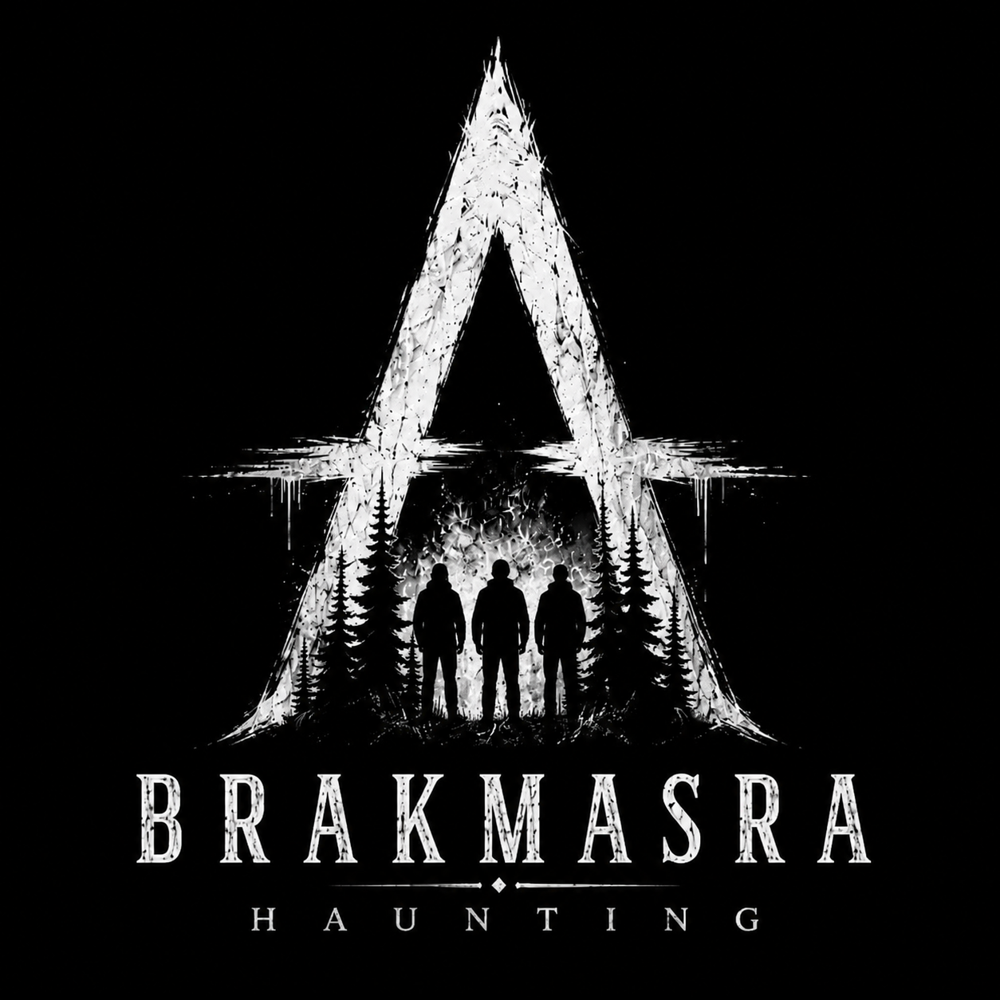

<div align="center">
  

  # 🌟 BRAKMASRA 🌟

  **The Official BRAKMASRA Merchandise Storefront**

  [](https://nextjs.org/)
  [](https://react.dev/)
  [](https://www.typescriptlang.org/)
  [](https://supabase.com/)
  [](https://orm.drizzle.team/)
  [](https://vitest.dev/)
</div>

<br />

Welcome to the **BRAKMASRA** source repository! 🚀 This is a high-performance, dark-luxury e-commerce platform built natively on Next.js 16.

> 🔒 **Public Launch State**: The site is currently configured in a safe launch mode (`BRAKMASRA_LAUNCH_MODE=on`). Visitors can browse the upcoming collection, but member access, cart, checkout, and purchasing are locked behind branded "coming soon" gates. The fully completed authentication and commerce foundations remain safely behind feature flags until you are ready to drop!

---

## ✨ Features Included

- 📱 **Fully Responsive:** Beautifully crafted pages for Home, Shop, Product, About, Contact, Account, Cart, Checkout, Auth, and Admin.
- 🚧 **Launch Gates:** Polished "coming soon" overlays for unfinished purchasing journeys to build hype safely.
- 🗄️ **Secure Data:** Supabase PostgreSQL schema & Drizzle migrations, fortified with Row-Level Security (RLS).
- 🛡️ **Hardened APIs:** Server-validated endpoints with Zod, honeypots, strict origin checks, and robust rate limiting.
- 🔐 **Authentication Ready:** Complete Supabase Email/Password and Google OAuth foundations (currently disabled for safety).
- 🛒 **Commerce Core:** Local cart state and a guarded checkout adapter boundary.
- ♿ **Accessibility & SEO:** Content Security Policy (CSP), security headers, accessible focus states, reduced-motion support, sitemap, robots.txt, and dynamic social cards.
- ⚡ **Sleek UX:** Silky smooth route loading states and an immersive first-visit loader.

---

## 🛠️ Local Development

Requirements: **Node.js 24 LTS** (see `.nvmrc`) and **npm**.

```bash
# 1. Install dependencies
npm ci

# 2. Setup your local environment
copy .env.example .env

# 3. Spin up the dev server
npm run dev
```

🌐 Open [http://localhost:3000](http://localhost:3000) and enjoy the vibes.

---

## 🚦 Launch Gate System

Your production environment comes with a built-in safety net:

```env
BRAKMASRA_LAUNCH_MODE=on
AUTH_DEMO_MODE=
```

- **`BRAKMASRA_LAUNCH_MODE=on`**: Enables the public "coming-soon" release. It is a server-only fail-safe that blocks access to authentication, cart, checkout, and purchasing.
- **`BRAKMASRA_LAUNCH_MODE=off`**: Flips the switch! Unlocks the complete e-commerce experience.
- **`AUTH_DEMO_MODE=on`**: For local testing only! With launch mode off, it creates a fake member session without hitting Supabase. (Automatically disabled in production).

---

## 🔑 Environment Variables

Check `.env.example` to see exactly what you need. **Never commit your `.env` file!**

🔑 **Required for Production:**
- `NEXT_PUBLIC_SITE_URL`: Your exact domain (e.g., `https://brakmasra.com`)
- `SUPABASE_URL`, `SUPABASE_PUBLISHABLE_KEY`, `SUPABASE_SECRET_KEY`
- `DATABASE_URL`: Server-only PostgreSQL pooler URL for Drizzle
- `BRAKMASRA_LAUNCH_MODE`: Controls the launch gate.

> ⚠️ **SECURITY WARNING:** Never expose database URLs, Supabase secret keys, Stripe secrets, or email credentials through a `NEXT_PUBLIC_` variable!

---

## 🗃️ Database (Supabase + Drizzle)

The Supabase CLI manages migration history in `supabase/migrations/`. 

```bash
# Link your project & push migrations
supabase link --project-ref YOUR_PROJECT_REF
supabase db push
```

We use **Drizzle ORM** for incredible type-safe schema tooling (`db/schema.ts`). Need to view the DB locally? Just run:
```bash
npm run db:studio
```

---

## 🚀 Deployment Checklist

Before going live on **Vercel**, ensure you have:
1. [ ] Set the exact HTTPS `NEXT_PUBLIC_SITE_URL` and use Node.js 24 LTS.
2. [ ] Keep `BRAKMASRA_LAUNCH_MODE=on` until payments, stock, and policies are ready.
3. [ ] Add server-only Supabase secrets in Vercel, never in GitHub source. Set `BRAKMASRA_AUTH_MODE=on` only when member sign-in is ready.
4. [ ] Apply and verify the Supabase migrations, RLS, email templates, and exact allowed callback URLs in the production project.
5. [ ] Verify real email confirmation and the six-digit password-recovery flow. Recovery grants require `RECOVERY_SIGNING_SECRET` (32+ random characters) or the existing server-only Supabase secret.
6. [ ] Verify production routes, security headers, and access controls after deployment.

These are deployment checks to perform, not a claim that the remote project has already been configured. See the [security review](docs/security-review-2026-10-15.md) for local checks and outstanding development-tool advisories.

---

## 🧪 Quality Gate

Run this command suite before committing to ensure pristine code quality:

```bash
npm run lint       # ESLint check
npm run typecheck  # TypeScript validation
npm test           # Vitest unit tests
npm run build      # Next.js production build
npm audit --omit=dev --audit-level=high  # Production dependency security gate
```

---

## 🎨 Visual Assets

All bespoke hero images, account artwork, and product photography live in `public/images/`. The official brand mark is `logo.png`.
